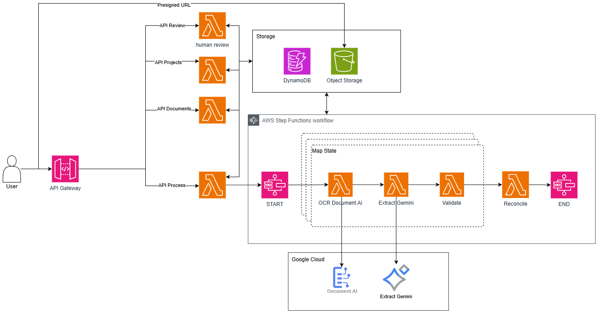

# AI Document Intelligence & Reconciliation Platform

Hệ thống AI **trích xuất – kiểm tra – đối soát** chứng từ doanh nghiệp **tiếng
Việt**: Purchase Order, hóa đơn, biên bản nghiệm thu.

Người dùng gom chứng từ vào một *project*, bấm xử lý; hệ thống OCR từng file
(Google Document AI), trích xuất thành JSON có cấu trúc (Gemini), kiểm tra bằng
rule nghiệp vụ **deterministic**, rồi đối chiếu chéo nhiều chứng từ để tìm mâu
thuẫn — lệch số tiền, lệch số lượng, sai ngày, thiếu tham chiếu. Kết quả **luôn**
đi qua Human Review trước khi được chốt.

Hạ tầng serverless trên **AWS** (API Gateway + Lambda + Step Functions +
DynamoDB + S3), AI chạy trên **Google Cloud** (Document AI + Gemini), IaC bằng
**Terraform**. Frontend React 19 + TypeScript + Vite + Tailwind v4.

Đo trên 6 chứng từ thật: OCR chính xác **97,6%**, dấu tiếng Việt **99,5%**, chi
phí **$0,021** — [evaluation/FINDINGS.md](evaluation/FINDINGS.md).

Bước OCR **đổi engine được ngay trên giao diện, cho từng chứng từ**: Google
Document AI Enterprise OCR (`dococr`, mặc định) hoặc Amazon Textract. Cả hai khai
chung trong
[backend/common/ocr_engines.py](backend/common/ocr_engines.py). Nhờ chọn được
theo từng lần chạy, hai engine so được trên **cùng một** tờ chứng từ.

Textract *không* hỗ trợ tiếng Việt — đo trên hoá đơn thật thì mất gần hết dấu
nhưng số đọc đúng hết, nên cảnh báo hiện ngay tại chỗ chọn engine. Vì vậy mặc
định là Document AI.

> **Trạng thái: POC đã có auth.** API Gateway yêu cầu **Cognito JWT** (`Authorization: Bearer <id token>`); frontend có cổng đăng nhập (Amplify, bắt đổi mật khẩu lần đầu). Chỉ khi chạy ở máy với `VITE_API_URL` localhost và thiếu `VITE_COGNITO_*` mới bỏ qua đăng nhập (`env=dev` trên AWS vẫn yêu cầu JWT). Đừng đưa dữ liệu thật chưa ẩn danh vào hệ thống.

---

## 1. Ba khái niệm cốt lõi

| Khái niệm | Vòng đời | Ghi chú |
|---|---|---|
| **Project** | Sống lâu dài | Chứa N chứng từ, được bồi thêm theo thời gian |
| **Processing Run** | Một lần chạy | OCR / Extract / Validate cho chứng từ **chưa xử lý** |
| **Reconciliation** | Một lần đối chiếu | Chạy trên **toàn bộ** chứng từ đã xử lý của project |

Hệ quả bắt buộc:

- Xử lý per-document là **idempotent** — chạy lại không tốn tiền AI thêm lần nữa.
- Đối chiếu là thao tác **project-level**, gọi lại thoải mái vì **không đụng AI**.

Nên thêm một biên bản nghiệm thu vào project đã xử lý sẽ **chỉ OCR file mới**,
các file cũ được bỏ qua, rồi đối chiếu lại trên toàn bộ. Đây là yêu cầu nghiệp
vụ, không phải tối ưu.

---

## 2. Kiến trúc



<sub>Vẽ bằng draw.io; file PNG nhúng sẵn XML nguồn nên không cần giữ `.drawio` riêng.
Muốn sửa: [app.diagrams.net](https://app.diagrams.net) → <b>File → Open From → Device</b> rồi chọn file PNG này.
Copy-paste hay kéo thả vào canvas KHÔNG được — clipboard chỉ mang pixel, phần XML nằm trong file.</sub>

> Hình chưa cập nhật: thiếu Lambda `api-anchor` (đổi chứng từ gốc), Cognito và
> Amplify. Số đúng là **5** Lambda api — xem [docs/iac-plan.md](docs/iac-plan.md) §3.

- **`states:StartExecution` chỉ ở `api-process`** — quyền *tiêu tiền AI*, cô lập
  nó là lý do chính của việc chia năm. Bảng IAM:
  [docs/iac-plan.md](docs/iac-plan.md) §3.
- **Bảng định tuyến nằm ở hai nơi** (Terraform + `handler.py`) nên
  [`tests/test_routes.py`](backend/tests/test_routes.py) đọc thẳng `main.tf` để
  khoá lại.
- **Step Functions không chạm DynamoDB/S3** — mũi tên tới Storage trên sơ đồ là
  của các Lambda worker bên trong. Chi tiết:
  [docs/architecture.md](docs/architecture.md) §4.1.

Ba chi tiết của luồng xử lý mà sơ đồ chưa nói hết: **Map tách 3 state** để Gemini
trả 429 chỉ retry Gemini, không chạy lại Document AI (tốn tiền thật); **`Catch`
nằm bên trong iterator** nên một file hỏng không giết cả run, nó rơi sang
`MarkDocumentFailed` còn các file khác chạy tiếp; và Step Functions **không chờ**
Human Review — execution kết thúc ở `AWAITING_REVIEW`, review là API riêng.
Lý do đầy đủ: [docs/architecture.md](docs/architecture.md) §4–§6.

---

## 3. Cấu trúc repo

```
backend/
  api/         handler.py (router 5 miền) + projects · documents · process · reconcile · review · anchor
  workers/     ocr · extract · validate · reconcile · mark_failed + steps.py
  core/        validate.py (luật TRONG 1 chứng từ) · rules.py + compare.py + crosscheck.py
               (luật GIỮA nhiều chứng từ) — KHÔNG gọi AI
  common/      s3 · dynamodb · stepfunctions · ai_clients · audit · errors · ids
  schemas/     document.py (schema chung cho mọi loại) + registry.py
  devserver/   chạy backend ở localhost (moto giả lập AWS, AI THẬT)
  tests/       pytest, offline hoàn toàn
frontend/      React 19 + TS + Vite + Tailwind v4 — 2 màn hình
docs/ · evaluation/ · infra/    tài liệu · spike đo AI · Terraform
```

Mọi loại chứng từ dùng chung một schema (`schemas/document.py`). Thêm loại mới =
thêm tên vào `DOCUMENT_TYPES` trong `registry.py` + (nếu cần) vài rule trong
`core/rules.py`. **Không** phải sửa Step Functions, API hay data model — danh
sách loại trong prompt được **sinh ra từ registry**.

---

## 4. Chạy ở máy

Hai terminal: backend trước, frontend sau. Không cần tài khoản AWS — dev server
giả lập AWS bằng `moto`.

| Phần | Hướng dẫn |
|---|---|
| Backend: cài lần đầu, credential, lệnh chạy, tuỳ chọn, chi phí | [backend/devserver/README.md](backend/devserver/README.md) |
| Frontend: cài, lệnh chạy, mô tả giao diện | [frontend/README.md](frontend/README.md) |

> **Dev server gọi AI THẬT và tốn tiền thật.** Chỉ hạ tầng AWS được giả lập;
> Document AI và Gemini luôn gọi thật. Đơn giá và cách tránh tốn tiền lặp nằm ở
> file backend ở trên.

---

## 5. Test và lint

```powershell
cd backend; .venv\Scripts\python.exe -m pytest -q
cd backend; .venv\Scripts\python.exe -m pyflakes api common core schemas workers tests devserver
cd frontend; npm run typecheck
```

**Phải chạy từ trong `backend/`** (import phụ thuộc CWD). Test **offline hoàn
toàn** — không cần AWS thật (`moto`) lẫn Google credential (`ai_clients.py`
import lazy trong hàm). Kiểm thử Step Functions không cần deploy, không cần
Docker: [infra/statemachine-test/README.md](infra/statemachine-test/README.md).

---

## 6. Deploy lên AWS

Toàn bộ các bước — cài Terraform, credential, tạo processor, build 11 gói
Lambda, `apply`, deploy frontend, kiểm tra sau apply, xoá hạ tầng — nằm ở
[infra/README.md](infra/README.md).

---

## 7. Tài liệu chi tiết

| Tài liệu | Nội dung |
|---|---|
| [docs/architecture.md](docs/architecture.md) | Kiến trúc, lý do chọn Step Functions và polling |
| [docs/data-model.md](docs/data-model.md) | 4 bảng DynamoDB, GSI, layout S3 |
| [docs/schemas.md](docs/schemas.md) | Schema chung, danh sách cờ và rule đối chiếu |
| [docs/iac-plan.md](docs/iac-plan.md) | Toàn bộ tài nguyên AWS và API surface |
| [docs/openapi.yaml](docs/openapi.yaml) | Tài liệu API theo chuẩn OpenAPI 3.0: 15 đường dẫn, thân yêu cầu, phản hồi và mã lỗi |
| [docs/observability.md](docs/observability.md) | Audit + monitoring 3 lớp, dashboard, cách mentor xem (đề xuất) |
| [backend/devserver/README.md](backend/devserver/README.md) | Dev server, chi phí từng processor, dev/cloud tách nhau thế nào |
| [frontend/README.md](frontend/README.md) | 2 màn hình, presigned POST, polling tiến độ |
| [evaluation/README.md](evaluation/README.md) | Spike đo chất lượng AI, nguồn dataset tiếng Việt |
| [evaluation/FINDINGS.md](evaluation/FINDINGS.md) | Kết quả đo trên chứng từ thật |
| [infra/README.md](infra/README.md) | Deploy Terraform từ đầu đến cuối |
| [infra/statemachine-test/README.md](infra/statemachine-test/README.md) | Kiểm thử ASL, không cần Docker |

---

## 8. Chưa làm

WebSocket cho progress (hiện dùng polling, nâng cấp sau bằng DynamoDB Streams mà không phải sửa worker) · dataset 50–100 tài liệu kèm ground truth · test frontend · dark mode · phân trang.
